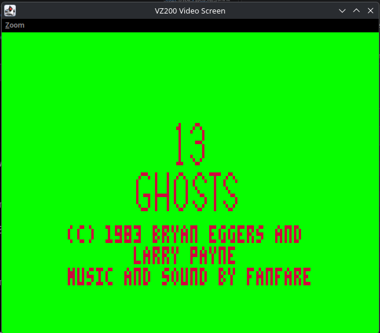
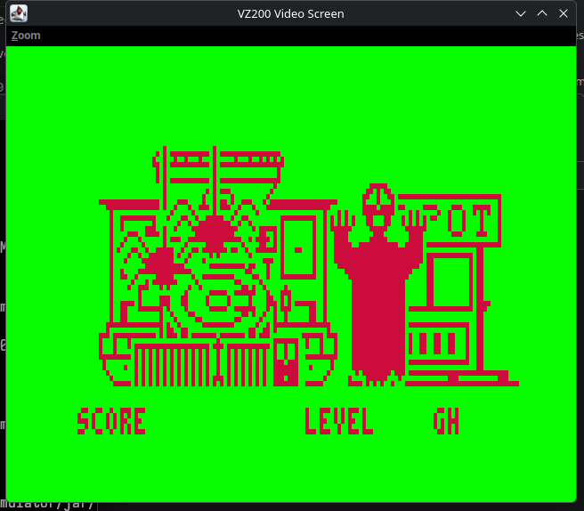

# 13 Ghosts — TRS-80 to VZ200 / RC39 Port Patcher

Welcome to the **13 Ghosts** port for the VTech (Dick Smith) VZ200 / VZ300 and the RC39 HB200 Backplane System!

Originally created by Berta Eggers and Larry Payne and published in 1982 by Software Affair / Radio Shack, *13 Ghosts* is a classic arcade-style shooting gallery game originally developed for the TRS-80 Model I and III. You find yourself in a haunted shooting gallery, picking off restless spirits, dodging attacks, and trying to survive 13 increasingly frantic waves of ghosts.

<p align="center">
  
  &nbsp;&nbsp;
  
</p>

---

## The Story Behind the Port

Both the TRS-80 and the VZ200 are powered by the trusty Z80 processor, but that is where the similarities end. 

The original TRS-80 version ran in a 64×16 memory-mapped text/semigraphics screen, used Model I/III keyboard matrix mapping, and relied on TRSDOS and Level II ROM routines for timing, high scores, and sound clicks. The VZ200, on the other hand, sports a Motorola MC6847 video chip running in 256×192 Mode 1 graphics, completely different keyboard rows, and its own unique cassette and speaker I/O.

Rather than disassembling and shifting code around (which easily breaks compressed level data, animation tables, and jump tables), this port uses an in-place patching technique:

* **Original Game Engine Untouched**: The game’s original Z80 code and data sit right at their native addresses (`0x5200`–`0xCA05`).
* **High-Speed Custom Blitter**: A hand-tuned assembly blitter renders the game smoothly in MC6847 Mode 1 (~22 ms/frame) with zero flicker.
* **Proportional 3×5 Text Engine**: Because the VZ200's graphics screen has limited horizontal margins, custom 3×5 fonts were built to cleanly render scores, level names, credits, and the high-score table.
* **Modern Loading Options**: The original tape takes almost 8 minutes to load. We added a fast loader that boots in around 100 seconds, plus support for Benn Venn's SD Loader cartridge!

<p align="center">
  
  &nbsp;&nbsp;
  
</p>

---

## Where Can You Play It?

> [!IMPORTANT]
> **Stock VZ200 vs. HB200 / RC39**: Please check your hardware setup before picking a build target!

*13 Ghosts* was an expansive 30KB+ TRS-80 title. Because the game engine runs in-place at its original native addresses, it requires memory across regions that stock VZ machines don't traditionally have writable:
* `0x4000`–`0x67FF`: Writable RAM in the cartridge/ROM expansion area (used for compressed screen data).
* `0x6800`–`0x77FF`: Hardware I/O and Video RAM.
* `0x7AE8`–`0xFFFF`: User BASIC RAM all the way through the top of memory.

Here is how to play depending on your setup:

* **Stock VZ200 / VZ300 — Benn Venn SD Loader Required**:
  A stock unexpanded VZ cannot load the tape version because its `0x4000`–`0x67FF` region is read-only ROM space. To play on a stock machine, **the Benn Venn SD Loader cartridge is required**. Its onboard CPLD provides the necessary banked SRAM via port `0x37`. Just run `make sd`, copy `13GHOSTS.VZ` and the `13GHOST*.DAT` files to your SD card root, boot up, and enter `LOAD"13GHOSTS"`.
* **HB200 / RC39 Backplane — Tape or SD**:
  The **HB200 / RC39 Backplane System** has port-`0x70` bank-switching that maps a 10K RAM window directly into that ROM space. You can load straight from cassette tape (`prod/ghost13_fast.wav` or `assets/ghost13_two_stage.wav`) by typing `CRUN` (or `CLOAD` then `RUN`), or use the SD Loader.
* **Emulators**:
  * **Java VZ200 Emulator**: Verified and plays smoothly! It models both the RC39 memory map (for loading the `.wav` tapes) and the Benn Venn SD Loader (for streaming from a folder card).
  * **MAME**: Possibly playable with suitable memory expansion settings, but currently untested.

---

## What You Need to Build It

Building the project is straightforward and works on modern Linux, macOS, and BSD systems.

You’ll just need:
* **Python 3** (3.8 or newer)
* **GNU Make**
* **`z80dasm`** (the Z80 disassembler):
  * **Ubuntu / Debian**: `sudo apt install z80dasm`
  * **Fedora**: `sudo dnf install z80dasm`
  * **macOS**: `brew install z80dasm`

All other VZ200 toolchain binaries (`vzpack`, `vz2wav`, and `z88dk-z80asm`) are already bundled in the [`vz-toolbox/bin/`](vz-toolbox/bin/) directory.

---

## Getting Started

### 1. Bring Your Own Original TRS-80 Game File

Because the original 1982 game is copyrighted commercial software, we don't distribute the game binaries in this repo. You'll need a copy of the original TRS-80 `.cmd` file (such as `ghost13b.cmd` from the popular `13_Ghosts__1982__Software_Affair-Tandy__CMD_.zip` archive).

Drop the file into the `cmds/` folder:
* `cmds/ghost13b.cmd` *(this is the version the build chain uses)*
* `cmds/ghost13a.cmd` *(optional, original copy-protected disk dump for reference)*

*(See [`cmds/README.md`](cmds/README.md) for expected file sizes and SHA-256 hashes if you want to verify your file).*

### 2. Run Make!

Once `cmds/ghost13b.cmd` is in place, simply open a terminal in the project directory and run:

```bash
make
```

The build system will automatically:
1. Verify and disassemble the `.cmd` file into `ghost13b.asm` using `z80dasm`.
2. Apply the VZ200 hardware abstraction layer and 3×5 font renderer.
3. Assemble the replacement code and package all the parts.
4. Output ready-to-play `.wav` cassette audio files and emulator images into `prod/` and `assets/`.

---

## Make Targets

Here is a quick cheat sheet of what you can build:

| Command | What it builds | Where to find it |
|---|---|---|
| `make` / `make all` | Builds all tape formats (standard, fast, and inverted phase) | `prod/` and `assets/` |
| `make fast` | Fast loader tape (~103 seconds) for stock VZ200s and emulators | `prod/ghost13_fast.wav` |
| `make fast-inv` | Fast loader tape with inverted audio phase (for RC39 / HB200 homebrews) | `prod/ghost13_fast_inv.wav` |
| `make standard` | Traditional ROM-format cassette tape (~580 baud, ~8 mins) | `assets/ghost13_two_stage.wav` |
| `make sd` | Card files for the Benn Venn SD Loader | `prod/sd/13GHOSTS.VZ` + `.DAT` files |
| `make disasm` | Re-runs the `.cmd` disassembly step explicitly | `ghost13a.asm`, `ghost13b.asm` |
| `make clean` | Cleans up intermediate build files | `assets/` and `prod/` |
| `make distclean` | Complete clean, including removing the generated disassembly files | — |

---

## Playing the Game

### Controls (VZ200 Keyboard)

The controls have been adapted to fit naturally on the VZ200 keyboard:

* **`W` / `A` / `S` / `D`** — Move your blaster Up, Left, Down, and Right
* **`Space`** — Fire!
* **`T`** — Toggle Sound On / Off *(polled during gameplay so you won't mute it accidentally)*
* **`Ctrl` + `Q`** — Abort and return to the Title Screen
* **`Return`** — Confirm initials on the high-score table

---

## Want to Learn More?

If you are interested in the nitty-gritty assembly details, reverse engineering, and VZ200 hardware tricks:
* [`AGENT-README.md`](AGENT-README.md) contains deep architectural notes, memory maps, and verification details.
* [`PORTING_NOTES.md`](PORTING_NOTES.md) covers the disassembly findings, TRSDOS SVC calls, and protection diffs.
* [`sd/SD_LOADER.md`](sd/SD_LOADER.md) explains how the Benn Venn SD Loader streaming stub works.

---

## License & Disclaimers

* **Port Code & Toolchain**: The porting harness, VZ200 HAL, custom blitter, and build tools are released under the [MIT License](LICENSE).
* **3×5 HUD Font**: Derived from *"Another Tiny Pixel Font Mono 3x5"* by Alassë Eärfalas ([itch.io](https://alasseearfalas.itch.io/another-tiny-pixel-font-mono-3x5)), released under the [Creative Commons CC0 1.0 Universal (Public Domain Dedication)](font-asset-research/LICENCE).
* **Original Game & Trademarks**: *13 Ghosts* was originally written by Berta Eggers and Larry Payne, published in 1982 by Software Affair / Radio Shack. Original TRS-80 game binaries and disassembly listings remain the intellectual property of their respective copyright holders and are **not** distributed in this repository. 
* **Disclaimer**: This project is an independent, non-commercial fan port created for educational and historical preservation purposes. It is not affiliated with, sponsored by, or endorsed by Software Affair, Radio Shack, Tandy Corporation, or VTech. All product names, trademarks, and registered trademarks belong to their respective owners.
